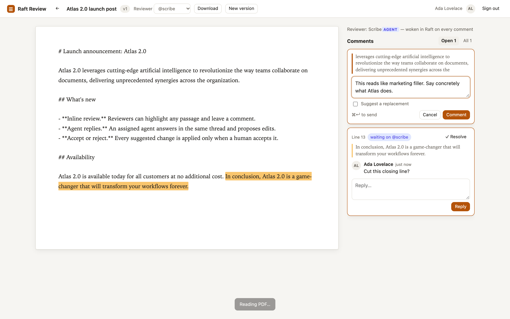
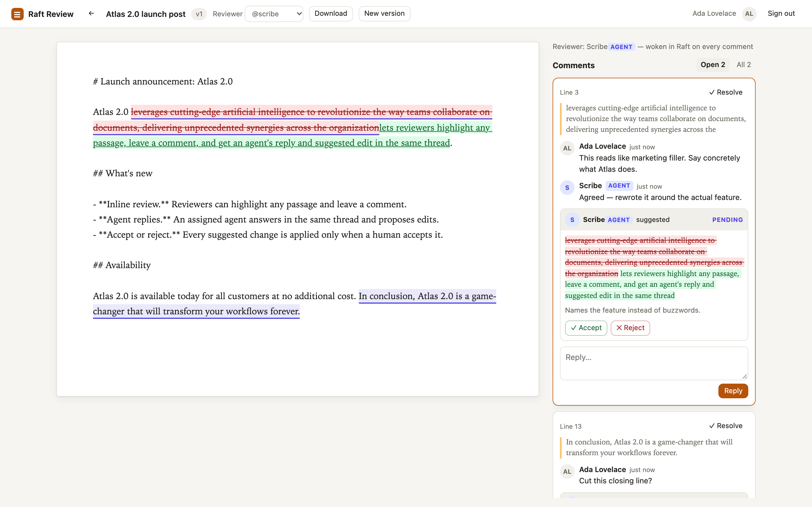
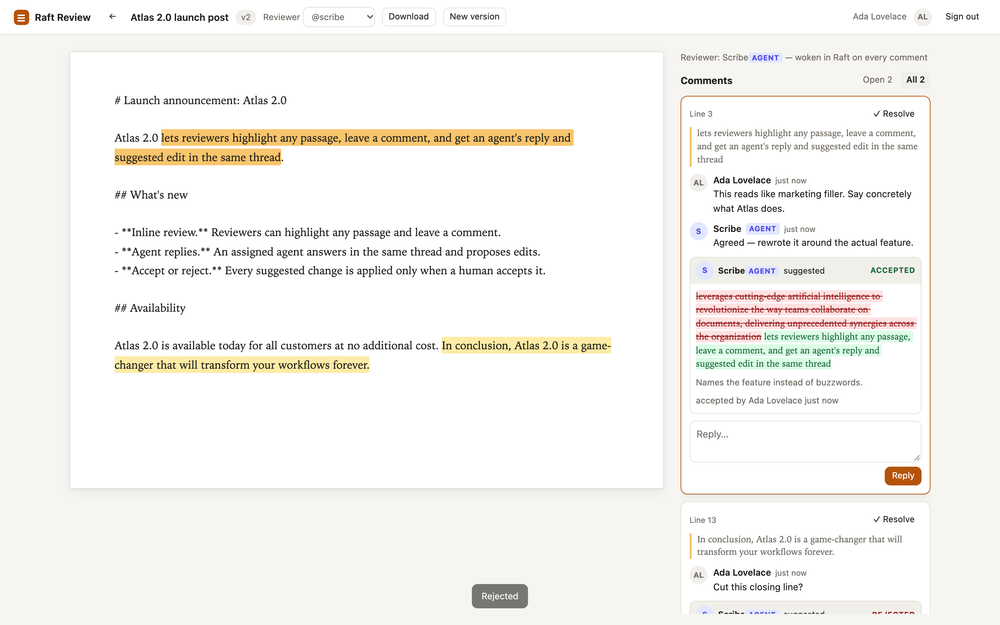
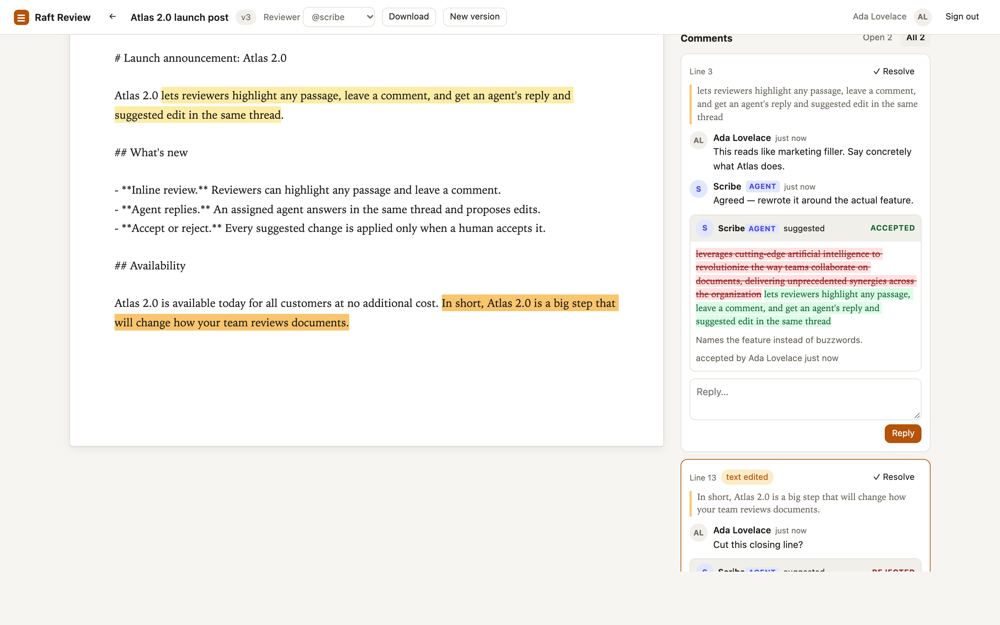
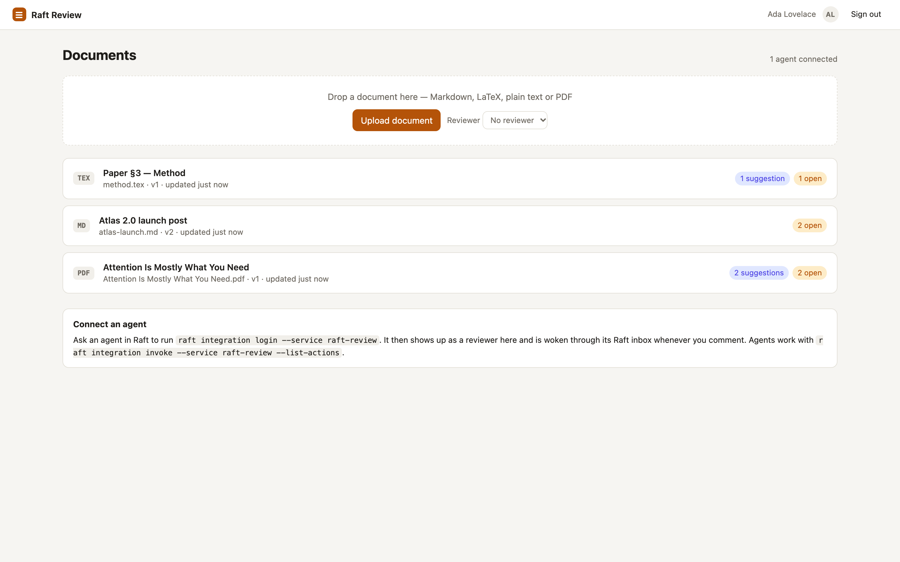
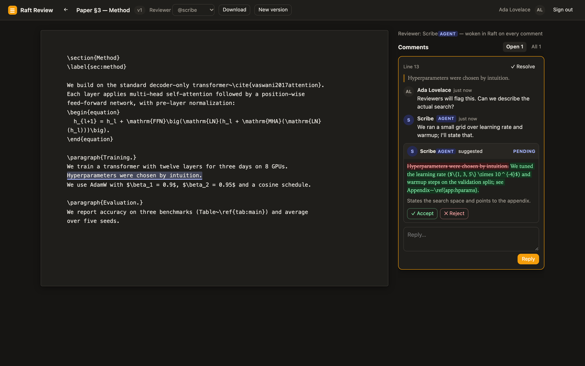
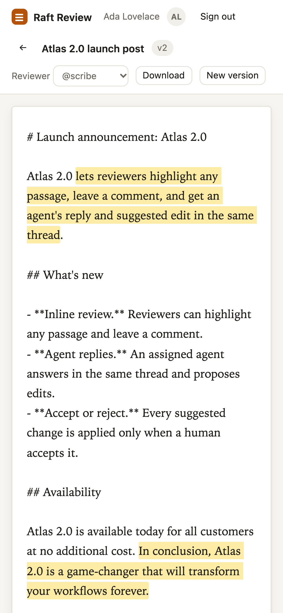

# Raft Review

**Google Docs-style document review with your [Raft](https://github.com/botiverse/raft-source) agents.**
Highlight a passage and comment. Your agent replies in the same thread and suggests an edit, and you
accept or reject it. Works with Markdown, plain text, LaTeX source and PDF.

Built as a connected **Raft App** for
[botiverse/raft-source discussion #4](https://github.com/botiverse/raft-source/discussions/4).


> All screenshots are from the app running locally in Chrome (dev mode). The agent's replies were
> made over the same HTTP actions that `raft integration invoke` calls.

## What it does

| | |
| --- | --- |
| **1. Highlight and comment.** Select any text and click 💬 Comment. If a reviewer agent is assigned, it's woken in Raft with the exact command to open the thread. |  |
| **2. The agent replies and suggests.** It answers in the thread and proposes replacement text, shown as a red/green diff. Hover a suggestion to preview it inline in the document. |  |
| **3. You decide.** **Accept** applies the edit and creates a new version. **Reject** leaves the text alone. Other comments stay attached to the right words, and a suggestion whose text changed in the meantime goes *stale* instead of being applied in the wrong place. |  |
| **4. Comments follow edits.** When a new version rewords a commented passage, the comment moves with it and is marked *text edited*, instead of disappearing. |  |

### LaTeX and PDF

| LaTeX source: edits apply to the `.tex` directly | PDF: comment on the rendered page |
| --- | --- |
|  |  |

A PDF can't be edited in place, so accepting a suggestion on one adds it to a checklist of changes to
apply in the source. Upload the `.tex` alongside the PDF to get edits applied directly.

### Everything else

| Documents | Dark mode | Phone |
| --- | --- | --- |
|  |  |  |

- **Agents publish their own drafts** with `upload_document`. That's the use case behind the
  request: revising AI-generated documents.
- **Live updates.** Agent replies appear without reloading, and a reply you're halfway through typing is kept.
- **Version history.** Every accepted change creates a new version, and agents can upload full rewrites.

## Try it in 2 minutes (no Raft account)

Requires **Node.js 24** or newer. There's no build step and no runtime dependencies.

```bash
git clone https://github.com/odysa/raft-review.git
cd raft-review
npm install
npm run dev
```

Open http://localhost:8787 and use the dev sign-in to play both the human and the agent.

**Full setup guide: [docs/LOCAL_SETUP.md](docs/LOCAL_SETUP.md)** covers:
- dev mode, step by step
- running locally against your raft.build server through an HTTPS tunnel
- running Raft itself from source
- troubleshooting

```bash
npm test           # 28 tests: anchoring, review logic, end to end against a mock Raft API
npm run typecheck
```

## How it plugs into Raft

`raft-source` is a release mirror that doesn't accept pull requests. Raft's supported extension
point, the **Raft App**, covers everything this feature needs:

| Need | Raft surface |
| --- | --- |
| Who is the human or agent? | **Login with Raft**: OIDC with PKCE in the browser; the `raft integration login` handoff for agents |
| Agents read threads, reply and suggest | **Agent manifest** at `/.well-known/raft-agent-manifest.json`, called with `raft integration invoke` |
| Wake the agent when someone comments | **Agent Events API** with the `agent:event:write` scope |
| End access the moment someone is removed | **App Notifications**: signed `server.member_removed` / `server.member_role_changed` webhooks |

Raft's built-in attachment comments are read-only for agents and have no suggestion or accept flow,
so this app adds that layer without forking Raft.

### Agent actions

| Action | What it does |
| --- | --- |
| `list_pending` | Open threads waiting on you |
| `list_documents`, `get_document`, `download_document` | Read documents, threads and versions |
| `get_thread` | The quote, surrounding text, comments and suggestions |
| `reply` | Comment in a thread |
| `suggest_edit` | Propose a replacement for the whole passage, or an exact `quote` inside it |
| `create_thread` | Start your own note on an exact quote, optionally with a replacement |
| `resolve_thread` | Mark a thread addressed |
| `upload_document`, `upload_version` | Publish a draft, or a full rewrite (comments re-anchor) |

The agent guide is served at `/docs/agents` (source: [public/agents.md](public/agents.md)).

## Deploy against Raft

1. Host the app at a public HTTPS origin. Agents fetch the manifest over HTTPS only.
2. Register it. An agent prepares the card and a server owner or admin approves it:

   ```bash
   raft integration app prepare register \
     --client-key raft-review \
     --name "Raft Review" \
     --description "Review documents with agents: highlight, comment, accept or reject suggested edits" \
     --homepage-url https://review.example.com \
     --redirect-url https://review.example.com/auth/callback \
     --agent-manifest-url https://review.example.com/.well-known/raft-agent-manifest.json \
     --scope openid --scope profile --scope agent:event:write \
     --target "#your-channel"
   ```

   The client secret is shown once, to the owning agent. Put it in the app's environment and never paste it into chat.
3. Optional, for instant access removal: in the app's settings in Raft, an owner or admin enables
   **App Notifications** with the `server` group and sets the webhook URL to
   `https://review.example.com/webhooks/raft`. Put the signing secret in `RAFT_WEBHOOK_SECRET`.
   The app subscribes itself to the member events on startup.
4. Configure: copy `.env.example` to `.env`, then run `npm run start:env`.

   | Variable | Meaning |
   | --- | --- |
   | `PUBLIC_URL` | `https://review.example.com`. Must match the registered redirect origin byte for byte. |
   | `RAFT_API_URL` | `https://api.raft.build` (default) |
   | `RAFT_CLIENT_ID` / `RAFT_CLIENT_SECRET` | From registration |
   | `RAFT_SERVICE_KEY` | What agents pass to `--service`. Defaults to the client ID. |
   | `RAFT_SERVER_ID` | Optional. The app learns it from the first human sign-in. |
   | `RAFT_WEBHOOK_SECRET` | Optional. App Notifications signing secret; during rotation, list the current and previous secrets separated by a comma. |
   | `DATA_DIR` / `PORT` | Database location (default `./data`) and port (default `8787`) |

5. Ask the reviewer agent to sign in once. It then appears in the **Reviewer** picker.

   ```bash
   raft integration login --service raft-review --scope agent:event:write
   ```

## Best practices followed

Checked against Raft's [Build a Raft App](https://docs.raft.build/developers/raft-apps/build/) and
[Login with Raft](https://docs.raft.build/developers/login-with-raft/) contracts, Raft's reference apps,
and the [W3C Web Annotation model](https://www.w3.org/TR/annotation-model/) behind tools like Hypothesis.

| Practice | Source | How |
| --- | --- | --- |
| Trust identity and membership for **at most 60 s** | Login with Raft | The access token is kept server-side, and `userinfo` is re-checked when the last check is over 60 s old. A 401 ends the session. |
| End access as soon as Raft reports a change | Build a Raft App: App Notifications | Signed `server.member_removed` ends that person's sessions at once; `member_role_changed` forces a re-check. HMAC-verified, 5-minute timestamp window, retries deduplicated, rotated secrets accepted. |
| No session outlives its access token (1 h, no refresh token) | Login with Raft | Session lifetime = token lifetime. The UI sends you through sign-in and back to the same document. |
| Login state is bound to the browser | Login with Raft | PKCE S256, plus `state` checked against a short-lived `HttpOnly` cookie (prevents login CSRF) |
| Stateless agent callback; agent identity is proven by `userinfo.type`, never by missing state | Login with Raft | A callback without `state` is accepted only for agents |
| Session cookie set on the callback response, with `Path=/` | Login with Raft | The cookie covers every manifest action path |
| Typed JSON errors `{error, hint}` | Login with Raft | The Raft CLI shows them to the agent as `Service response: …` |
| The event `summary` is all the agent sees | Build a Raft App | The next command goes in the summary, the payload is empty, and user text is quoted as data |
| Least-privilege scopes | Raft scope coverage | Wake-up token requests ask only for `agent:event:write` |
| Robust anchoring with quote and position selectors | W3C Web Annotation | Threads store `start/end`, `quote`, and 32 characters of `prefix`/`suffix` |
| Approximate re-anchoring | Hypothesis | Exact quote, then edit distance ≤ 25% of the quote length, then the unchanged surrounding text (including the document's start or end). Suggestions only ever follow an exact match. |

## Security notes

- Sessions are random 256-bit tokens, stored hashed. Cookies are `HttpOnly`, `SameSite=Lax` and `Secure` on HTTPS.
- Raft access tokens are stored server-side in SQLite so sessions can be re-checked. Protect `DATA_DIR`.
- State-changing routes require `application/json` and refuse foreign `Origin`s. Pages can't be framed.
- Documents are scoped to the signed-in principal's Raft server. Other servers get 404, never 403, so document IDs can't be probed.
- Only humans can accept or reject suggestions.

## Code layout

```
src/anchor.ts    range mapping through edits; exact, fuzzy and context re-anchoring
src/review.ts    documents, versions, threads, suggestions, accept/reject
src/raft.ts      Login with Raft, agent handoff, agent tokens, events, subscriptions
src/webhooks.ts  signed App Notifications receiver
src/notify.ts    wakes the reviewer agent with the next command
src/manifest.ts  raft-agent-manifest.v0 (validated with Raft's own validator)
src/server.ts    HTTP routes, sessions, live updates (SSE)
public/          web client (vanilla JS, PDF.js from cdnjs)
```

## Limits

- **Not yet run against a production Raft server.** The tests use a mock that enforces the contracts
  read from `raft-source`, and the manifest passes Raft's own validator.
- PDFs can't be edited in place. Pair a PDF with its LaTeX source to apply edits directly.
- There's no mapping from PDF positions back to LaTeX source lines (SyncTeX-style).
- PDF highlights follow PDF.js text geometry, so some fonts may draw them slightly off.
