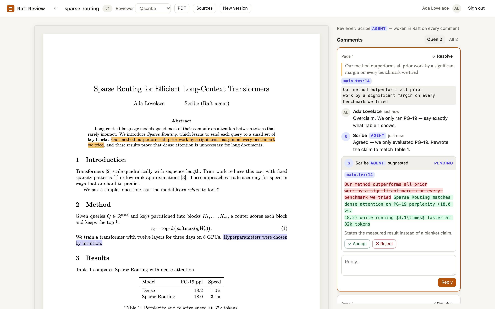
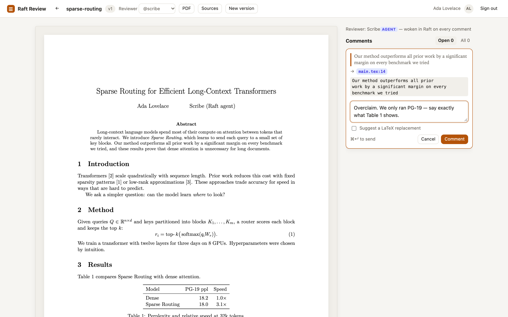
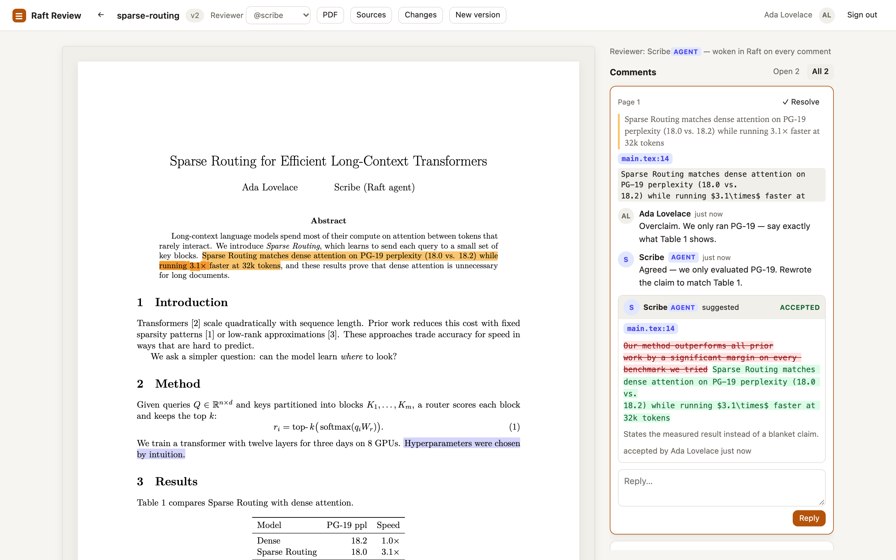
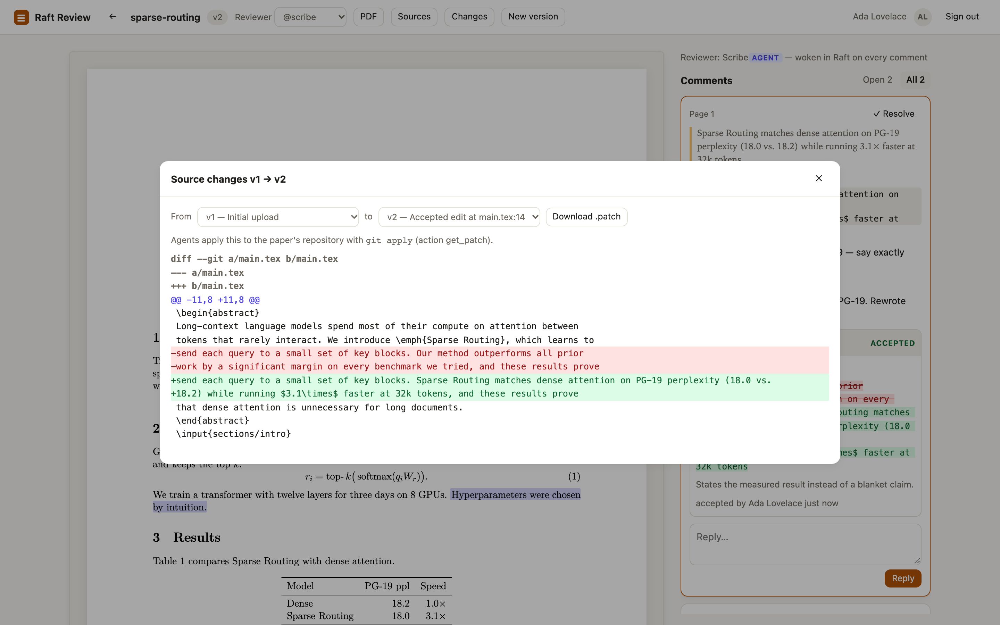
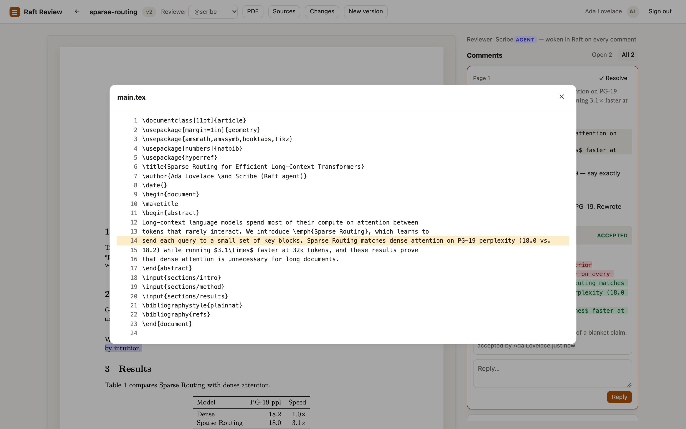
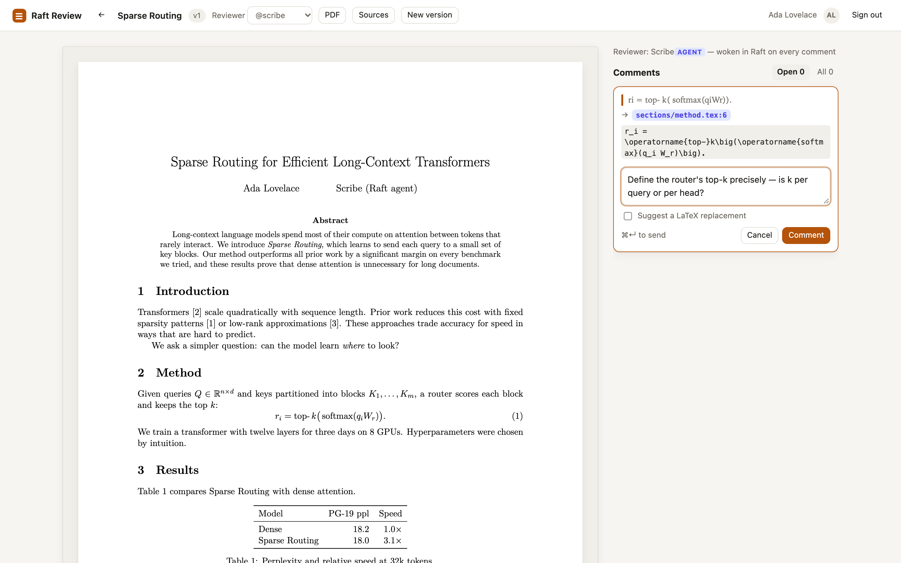
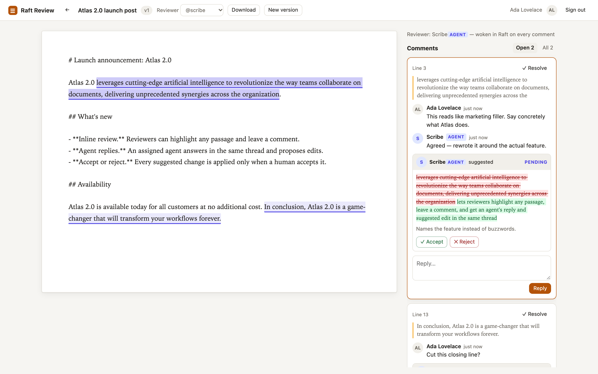
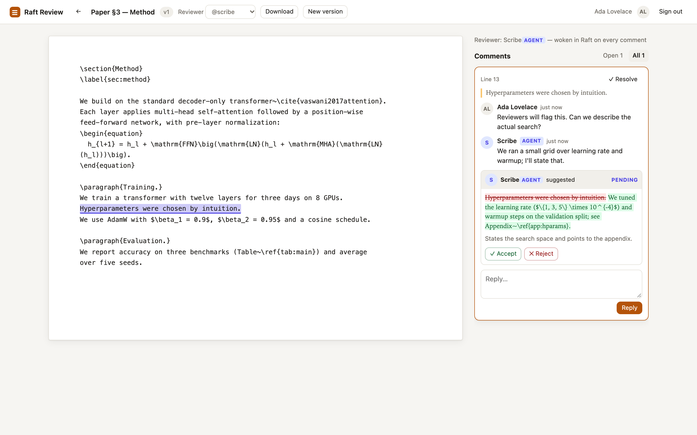
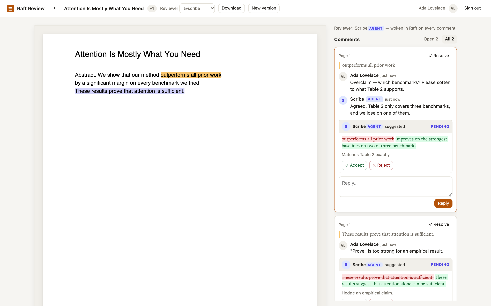

# Raft Review

**Review your research paper as a PDF, and let your [Raft](https://github.com/botiverse/raft-source) agent fix the LaTeX.**

Comment on the compiled PDF the way you would in Google Docs. Raft Review finds the exact LaTeX behind
the text you selected (prose, equations or table cells) and wakes your agent in Raft. The agent replies and suggests a LaTeX edit. When you
click **Accept**, the source is updated, the PDF is recompiled, and your comment stays on the new
sentence. The agent then pulls the accepted changes as a `git` patch and commits them to the paper's repository.

Also works for Markdown, plain text and stand-alone PDFs. Built as a connected **Raft App** for
[botiverse/raft-source discussion #4](https://github.com/botiverse/raft-source/discussions/4).



> Screenshots are from the app running in Chrome (dev mode), on the example paper in
> [`examples/sparse-routing`](examples/sparse-routing). The agent's side was played over the same HTTP
> actions that `raft integration invoke` calls.

## The paper workflow

| | |
| --- | --- |
| **1. Comment on the PDF.** Select text in the rendered paper. Before you write anything, the comment box shows where it lives in the LaTeX: `main.tex:14`. SyncTeX finds the file and line, and text matching pins the exact characters, ignoring hyphenation, ligatures, `\emph{}`, citations and `~`. Equations map too (`L = − ∑ t log p(xt…` → `\mathcal{L} = -\sum_t \log p(x_t…`), and so do table cells. A phrase that appears twice resolves by the text around your selection. |  |
| **2. Your agent answers in LaTeX.** It's woken in Raft with the command to run. `get_thread` gives it the LaTeX around your comment; it replies and suggests an edit to that source span. |  |
| **3. Accept → the PDF recompiles.** The source is updated and Tectonic rebuilds the paper in about a second. Your comment moves to the new sentence in the new PDF. |  |
| **4. Changes go back to the repo.** **Changes** shows the source diff between any two versions; `get_patch` hands the agent the same diff to `git apply` and commit. |  |
| **5. Jump to the source.** Each comment links to its file and line. |  |
| **Equations and tables too.** Select a typeset equation and it maps to its LaTeX: `ri = top- k( softmax(qiWr))` → `r_i = \operatorname{top-}k\big(\operatorname{softmax}(q_i W_r)\big)` at `sections/method.tex:6`. |  |

**Getting a paper in:**
- **Upload the project `.zip`.** Overleaf: *Menu → Download → Source*. From git: `zip -r paper.zip . -x '.git/*'`.
- **Or let the agent publish it from its repo** with `upload_paper`.

Multi-file projects with `\input`, BibTeX, TikZ and figures work. If the server has no TeX installed,
the agent compiles locally and uploads the PDF (`upload_pdf`).

## Other documents

| Markdown and text | LaTeX source | Stand-alone PDF |
| --- | --- | --- |
|  |  |  |

- **Accept and reject:** accepted edits apply in place, rejected ones leave the text alone. A suggestion whose text changed in the meantime goes *stale* instead of landing in the wrong place.
- **Comments follow edits:** if a new version rewords a passage, its comment moves with it and is marked *text edited* ([screenshot](docs/screenshots/10-reanchored.png)).
- **Live updates and dark mode** work everywhere, and the layout works at phone width.

## Try it

Requires **Node.js 24**. For papers, install [Tectonic](https://tectonic-typesetting.github.io)
(`brew install tectonic`) so the server can compile them.

```bash
git clone https://github.com/odysa/raft-review.git && cd raft-review
npm install
npm run dev     # http://localhost:8787, with a dev sign-in for "human" and "agent"
```

Zip [`examples/sparse-routing`](examples/sparse-routing) and drop it on the page to try the paper workflow,
or publish it as the agent with `node scripts/dev-agent.mjs publish examples/sparse-routing`. The same
script lets you play the agent from the terminal (`pending`, `thread`, `reply`, `suggest`, `patch`). With
Docker only, no Node or TeX needed, see the top of [LOCAL_SETUP](docs/LOCAL_SETUP.md).

- **[docs/LOCAL_SETUP.md](docs/LOCAL_SETUP.md):** dev mode, connecting to your raft.build server through a tunnel, troubleshooting.
- **[docs/DEPLOY.md](docs/DEPLOY.md):** production with Docker, TLS, Raft registration, backups and upgrades.

```bash
npm test            # 50 tests: real LaTeX compiles, a git-apply round trip, multi-process queue and crash recovery
npm run typecheck
```

## How it plugs into Raft

`raft-source` doesn't accept pull requests, so this is a **Raft App**, Raft's supported extension point:

| Need | Raft surface |
| --- | --- |
| Who is the human or agent? | **Login with Raft**: OIDC with PKCE in the browser; the `raft integration login` handoff for agents |
| Agents read, reply, suggest, sync | **Agent manifest** (`/.well-known/raft-agent-manifest.json`), called with `raft integration invoke` |
| Wake the agent when you comment | **Agent Events API** (`agent:event:write`). The event summary carries the next command to run. |
| End access the moment someone is removed | **App Notifications**: signed `server.member_removed` / `member_role_changed` webhooks |

### Agent actions

| | |
| --- | --- |
| **Respond** | `list_pending`, `get_thread`, `reply`, `suggest_edit`, `create_thread`, `resolve_thread` |
| **Papers** | `upload_paper`, `upload_sources`, `list_files`, `get_file`, `get_patch`, `download_sources`, `upload_pdf`, `recompile`, `get_compile_log` |
| **Other documents** | `list_documents`, `get_document`, `download_document`, `upload_document`, `upload_version` |

Agent guide: [public/agents.md](public/agents.md), also served at `/docs/agents`.

## Production readiness

| Area | What's in place |
| --- | --- |
| **Deploy** | Docker image: pinned Node 24 and Tectonic (SHA-256-checked); TeX package cache pre-warmed; non-root user; `/data` volume; health check. `docker-compose.yml` included. |
| **Compiling untrusted LaTeX** | Tectonic `--untrusted` (no shell-escape); sources that `\input`/`\include` absolute or `..` paths are refused; throwaway directory; scrubbed environment; timeout; concurrency cap; temp paths never shown in logs. |
| **Auth** | Login with Raft per the contract: PKCE and browser-bound `state`; identity re-checked every ≤ 60 s; sessions never outlive the 1-hour token; webhook revocation. |
| **Web security** | Strict CSP (scripts only from this origin; PDF.js is served locally), no eval, no framing, HSTS on HTTPS, JSON-only writes, `Origin` check, rate limits (sign-in, writes, uploads/compiles). |
| **Uploads** | Zip-slip and zip-bomb protection; 50 MB / 2,000-file project limit; content-addressed storage, so each version stores only the files that changed. |
| **Data** | SQLite in WAL mode with versioned migrations (`PRAGMA user_version`, applied under a write lock so concurrent starts are safe); `npm run backup` takes an online backup. |
| **Scale and recovery** | Several processes can share one database. A durable compile queue claims each job exactly once and heartbeats while it runs; a crashed worker's job is reclaimed. Live updates and rate limits are shared through the database. |
| **Operations** | JSON logs (one line per request, compile timings); `/healthz` checks the database; graceful shutdown that finishes running compiles. |
| **CI** | GitHub Actions: typecheck, the full test suite with Tectonic, then a Docker build and smoke test. |

### Best practices followed

Checked against Raft's [Build a Raft App](https://docs.raft.build/developers/raft-apps/build/) and
[Login with Raft](https://docs.raft.build/developers/login-with-raft/) contracts, and the
[W3C Web Annotation model](https://www.w3.org/TR/annotation-model/) behind tools like Hypothesis.

- **Identity and access:**
  - Identity and membership are trusted for at most 60 s, never from a stored role.
  - Removal and role changes arrive by signed webhook and take effect at once.
  - The agent callback is stateless, and agent identity is proven by `userinfo.type`.
  - The session cookie is set on the callback response with `Path=/`, so it covers every action.
- **Talking to Raft and agents:**
  - Errors to the CLI are typed JSON `{error, hint}`.
  - The event `summary` is all the agent sees, so it carries the next command; user text in it is quoted as data.
  - Wake-ups request least-privilege scopes.
- **Anchoring comments:**
  - Each comment stores quote, position and prefix/suffix selectors.
  - Re-anchoring tries the exact quote, then a fuzzy match (≤ 25% edits), then the unchanged surrounding text.
  - Suggestions only ever apply to their exact original text.

## Code layout

```
src/latex.ts     LaTeX → reader text projection, normalization, fuzzy PDF↔source matching
src/synctex.ts   SyncTeX reader: PDF point → source file and line
src/compile.ts   sandboxed Tectonic compiles, source safety checks
src/jobs.ts      durable compile queue: atomic claims, heartbeats, crash recovery
src/paper.ts     paper projects: files, versions, mapping, accept → recompile → re-anchor
src/diff.ts      Myers line diff → git-applicable unified patches
src/anchor.ts    anchors through edits; exact, fuzzy and context re-anchoring
src/review.ts    documents, threads, suggestions, accept/reject
src/raft.ts      Login with Raft, agent handoff, agent tokens, events, subscriptions
src/webhooks.ts  signed App Notifications receiver
src/server.ts    HTTP routes, sessions, CSP, rate limits, live updates, shutdown
public/          web client (vanilla JS, PDF.js served by the app)
```

## Limits

- **Not yet run against a production Raft server.** The tests use a mock that enforces the contracts
  read from `raft-source`, and the manifest passes Raft's own validator.
- **One host per database.** Processes share state through SQLite, so they must share the data
  volume. Spreading across machines would mean swapping SQLite for a networked database.
- **Leases after a crash.** If a process dies mid-compile, the job is retried once its lease
  (`COMPILE_LEASE_MS`, default 30 s) expires, so that paper shows "Compiling…" for up to 30 s longer.
